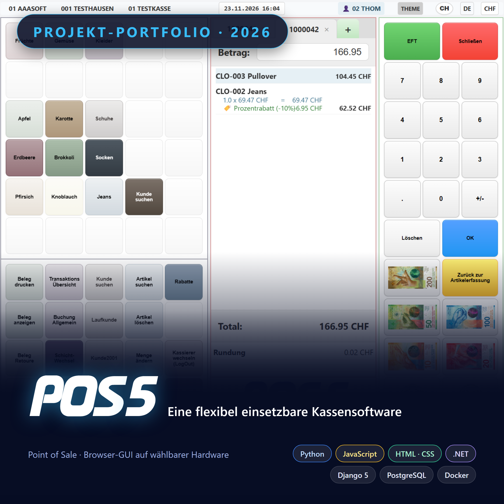

# POS5 — Projektvorstellung

**Eine flexibel einsetzbare Kassensoftware (2026)**

👉 **[Interaktive HTML-Präsentation öffnen (GitHub Pages)](https://thomj73.github.io/pos5-showcase/)**  
📄 **[Projektübersicht als PDF herunterladen](projektuebersicht.pdf)**

## Überblick

POS5 ist ein modernes, mandantenfähiges Point-of-Sale-System mit Touch-GUI im Browser und lokaler Hardware-Anbindung:

- **Backend:** Python 3.14, Django 5.2, PostgreSQL 16
- **Frontend:** HTML, CSS, JavaScript, htmx, jsPlumb
- **Hardware-Client (Windows):** .NET Framework 4.8 (Windows-Dienst, Systray-Tool, Updater, OPOS, EFT-Terminals: SIX TIM, ZVT, OPI)
- **Betrieb:** Docker Compose, gunicorn, nginx, WiX-MSI-Installer

> **Hinweis:** Dieses Repository enthält ausschließlich die öffentliche Projektvorstellung (HTML/CSS & PDF). Der Quellcode von POS5 befindet sich in einem privaten Repository.
